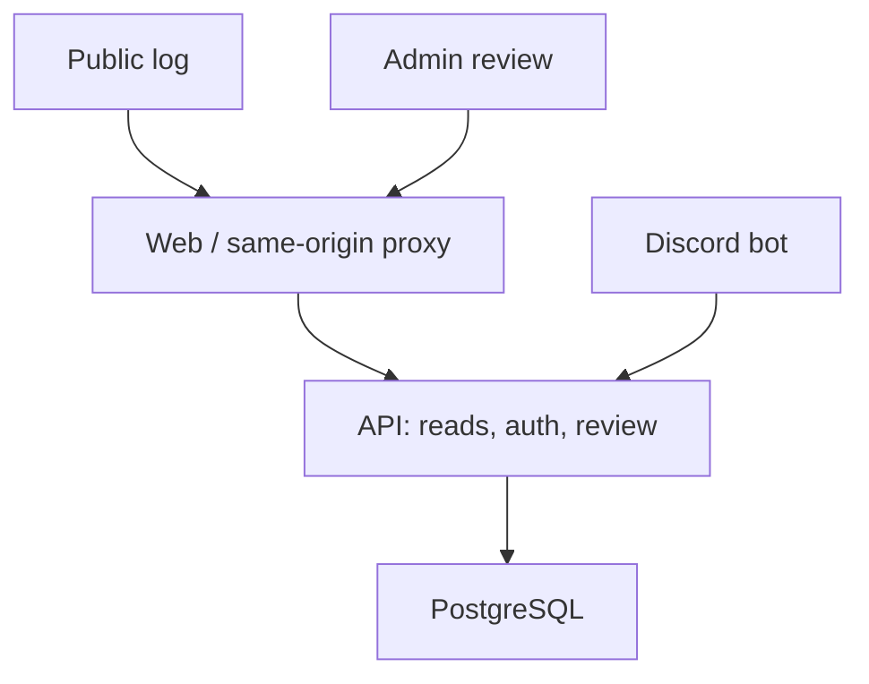

> **10 October 2026 release update:** The nine development migrations have been squashed to [001_baseline.sql](../packages/database/migrations/001_baseline.sql). The web proxy, API and optional bot share a single application container, separate from PostgreSQL. Historical implementation notes below may describe the old topology.

Administrator-managed labels, a dedicated site-settings page, moderator disable/delete and page-scoped item management are described in [site customization](site-customization.md). Migrations `007_site_customization.sql` and `008_default_clan_name.sql` preserve histories and administrator-chosen names. Generated clan keys use 32 hexadecimal characters; custom keys preserve any characters with a minimum length of 8. Migration `009_runelite_world_types.sql` retains original world flags separately from staff-correctable credit mode. Intake rejects excluded flags and binds retries to the normalized flag set.

Migration `012_runelite_auto_review.sql` adds private RuneLite world policies,
independent in-game clan matching and a player whitelist. Intake locks these
versioned rules and the current key, then commits evidence, any automatic
approval, audit and immutable receipt together. The unique item/world credit
index sends duplicate auto-approved claims to review without replacing credit.

[Collection log scheduling](collection-log-scheduling.md) adds a default-disabled
administrator switch and staff-managed overlapping page windows in migration 013. Every new intake locks the settings before catalog item locks and admits
items belonging to any currently open active page. Windows use persisted UTC
instants and the database clock; the editor shows local and UTC times.

# Architecture

The [WOM competition registry](wom-competitions.md) introduced by migration 014
owns one identity per source competition. SKILL results retain the existing XP
ledger and immutable import history; ACTIVITY results stay outside XP. Metadata
imports and linked schedule creation lock scheduling settings before XP state,
then catalog pages, and commit their audits and receipts atomically. Public
pages read local metadata and the top-three XP projection without contacting WOM.

> **8 October 2026 CAT-02 update:** [Admin catalog backend](admin-catalog-backend.md) implements authenticated creation, durable PNG icons, revision-checked ordering and explicit alias reconciliation. Compose now includes an icon volume, and backups include both database and icons. Earlier descriptions of those features as pending are superseded.

> **8 October 2026 CAT-01 update:** [Complete catalog import](catalog-import.md) now supplies 1,717 items, 124 ordered pages and verified local icons. Compose initializes the catalog after migrations; earlier descriptions of catalog import as pending are superseded.

> **8 October 2026 backend update:** [Backend phase 1](backend-phase-one.md) now implements public catalog/collection reads, Discord sessions and authenticated persistent settings. Statements below describing those services as pending are historical; intake/review, WOM and catalog import remain pending.

> **7 October 2026 revision:** [Mockup revision](mockup-revision.md) supersedes earlier combined HC styling, multi-collector, separate XP/member-table and public Admin-link requirements. It documents current preview behavior and outstanding live API work.

One TypeScript/npm-workspace repository and one PostgreSQL database keep the initial deployment small. The Discord bot is an adapter, not a second source of business rules or direct database writer. The API is the only planned submission/review/XP-import/catalog writer.

## Boundaries

Administrator-managed [clan branding](clan-branding.md) uses its own revision,
immutable raster logo/favicon pairs and an audited current pointer. Files live
in the existing icon volume. Public pages poll the branding projection, while
authenticated, CSRF-protected administrator writes preserve GIF/WebP animation
and generate a first-frame PNG favicon. Source images are never served directly.

The web proxy within the combined application container serves static assets and proxies `/api/` to the API. The external reverse proxy terminates TLS. Public endpoints return only catalog data and approved collection credits; proof links, pending claims, Discord IDs and audit metadata remain private.

The bot connects outbound to Discord's gateway and the internal API. Submission writes use a dedicated service credential, restricted to bot routes. The credential must not authorize staff routes. Human staff use individual administrator/moderator accounts, exact site origin, expiring server-side sessions and CSRF protection; Discord OAuth is not an admin login method. V1 does not require public visitors to log in.

`staff_accounts` stores permanent actor IDs, case-insensitively unique usernames,
roles, salted scrypt verifiers and a mandatory first-login password-change flag.
An additive migration extends sessions with account IDs and credential versions;
old shared sessions are invalidated. Password/username changes atomically advance
the credential version, revoke sessions and append an audit record without any
credential material. The current browser receives a replacement session. Each
request verifies its account version, preventing a late login from restoring
access with old credentials. A fresh authenticated installation requires an
operator-generated `ADMIN_BOOTSTRAP_PASSWORD` to create the sole administrator
as `admin`; no password is supplied by the application. Setup requires a different
password, after which the bootstrap environment value can be removed. Provisioning
checks the administrator role and the existing single-admin unique index, so
renaming/restarts/concurrent startup cannot reset an account. Missing credentials
on an uninitialized database prevent authenticated startup. Only that role can manage accounts or the
hardcore release flag; both staff roles can use review, submission, catalog and
XP tools after completing password setup.

Foundation API endpoints are `/healthz`, `/readyz` and `/api/v1/status`. Readiness checks that PostgreSQL is reachable and the migrated collection-state view exists; it does not indicate catalog/features are complete.

## Canonical identity

`items.id` is the stable internal canonical collection-log item identity. `game_item_ids` maps external OSRS source variants/aliases to it when source evidence justifies equivalence; external IDs do not define the internal namespace. Preserve existing canonical IDs permanently. The planned admin creation flow supports manual items with no external game ID, using a collision-safe allocator for imported and manual records. Never merge by display name alone.

`pages` describes the category and source page order. `page_items(page_id, item_id, slot)` supplies the many-to-many relationship and exact slot ordering. An item is stored once even when it occurs on multiple pages. All collection state is derived by canonical ID from approved submissions; no `collected` boolean is copied into page rows.

Initial schema: [001_initial.sql](../packages/database/migrations/001_baseline.sql). The schema has no catalog seed or fake approvals.

| Entity                  | Main invariant                                                                              |
| ----------------------- | ------------------------------------------------------------------------------------------- |
| `catalog_versions`      | Source URL/revision and import timestamp identify the checked-in snapshot                   |
| `items`                 | Stable canonical item ID; soft deactivation preserves existing credits                      |
| `game_item_ids`         | One source game item ID maps to exactly one canonical item                                  |
| `pages` / `page_items`  | Ordered slots; one occurrence of a canonical item per page                                  |
| `submissions`           | Unique Discord interaction ID; optional item while unmatched; approval requires item        |
| `audit_events`          | Before/after review values and authenticated actor                                          |
| `collection_credits`    | One current approved collector per canonical item and world mode; old claims remain private |
| `item_collection_state` | Item collected iff at least one approved credit exists                                      |

## Review transactions

An approval endpoint must authenticate an allowlisted admin, validate all fields, lock the submission and verify the client's expected version, resolve a real item, change status and insert an audit event in one transaction. Return 409 for stale/concurrent reviews. Increment `version` on every change. Record the actor from the session, never from a request body.

Rejecting a pending claim does not alter approved credits. Revoking an approval removes that credit from the derived public view. The same item can still be collected in the other world mode, but a unique partial index permits only one **current approved** credit for each `(item_id, hardcore)` pair. Earlier claims, rejections, corrections and revocations remain in the private audit history; Discord retries of the same interaction are idempotent.

The foundation SQL enforces basic foreign keys/status checks/idempotency uniqueness. Auth, input checks, review state transitions and append-only audit permissions are implementation tasks; the schema alone is not a complete review service.

## Catalog updates

Create a reproducible import tool with a reviewed snapshot, source revisions, item mapping, category/page ordering, icon manifest and attribution. Use primary source data from the game/community-maintained source, and compare against reference client screenshots. The OSRS Wiki collection-log page is a candidate taxonomy source; its contents have not been imported or verified in this foundation.

Diff every import. Retain canonical IDs, carry approved credits forward, add new items as uncollected, deactivate removed entries rather than deleting history, and reject dangling or ambiguous mappings. Validate complete coverage against the selected revision. Sharing an item between pages is different from merging similarly named items. The planned admin catalog overlay takes precedence for manual items, icons, memberships and explicit page ordering; source refreshes must preserve it and require explicit identity reconciliation when a newly imported item matches a manual entry.

## Planned hardcore and competition XP extensions

Hardcore remains a property of an approved collection credit. Add `submissions.hardcore` with a default-false value in a new forward migration, expose it in approved public credits, and derive `hardcoreCollected` by canonical item ID. Do not change the deployed initial migration or store separate flags in page slots. Review corrections and revocations use the existing versioned transaction/audit rules.

The public competition XP tracker is displayed below the homepage collection log (with `/xp` retained as an alias), not on a separate navigation page. The WOM adapter runs behind authenticated admin import endpoints; public clients read stored projections and never fetch WOM on each page load. The adapter parses an allowed competition URL, extracts its ID, and calls the fixed official API host. It uses current `metrics` and per-participation `deltas[].values.gained`, with a bulk per-skill preview for overall competitions where needed.

Planned tables/projections: imported competition identity/source metadata; WOM player identity/name snapshots; unique contributions keyed by `(competition_id, player_id, skill)`; import batches/audit records; and per-skill/member total projections. SQL XP totals use exact integer storage. Reconcile a complete validated snapshot in one transaction so an import retry or concurrent refresh cannot append the same gains twice. Separate XP import audit records from the existing submission-specific audit foreign key.

The baseline for a new skill is zero. Preserve any existing recorded site XP when migrating a later deployment. The skill total is that baseline plus all active stored competition/player contributions; refresh replaces a competition's contribution and changes totals by `new - previous`. All participant rows remain visible, including known-zero/unavailable source rows. Import reconciliation/history handles corrected gains, participant removals and changed metrics without silently rewriting prior credits.

The full [feature design](planned-features.md) defines mixed hardcore credits, exact XP arithmetic, metric handling, public/admin routes, failure behavior and verification. These are planned extensions; the initial SQL and foundation runtime do not implement them yet.

## Planned admin catalog maintenance

The Add item form requires icon, name and at least one existing page. The API creates one canonical item and its memberships atomically, initially appending it to each selected page. No credit or hardcore flag is created. Catalog/domain validation must support manual items without external game IDs; the current foundation validator still requires a nonempty `gameItemIds` array and will change in #30.

Record source/manual provenance, overrides, page revisions, icon assets and catalog audit events in forward-only migrations. The initial submission-specific `audit_events` table cannot record catalog actions without appropriate new storage. Keep the original migration intact. Imported IDs and the internal allocator must not collide or renumber existing items.

Reordering accepts a complete ordered list of canonical IDs and the expected page revision. Lock/check the page, validate an exact permutation of its current membership, and rewrite slots in a single transaction. Handle the existing unique `(page_id, slot)` constraint safely during swaps. Item creation/source membership changes also advance affected page revisions; stale editors receive 409. Neither item IDs, collection credits nor other pages change. Invalidate the catalog ETag and bot search cache after committed edits.

Upload bounded raster icons through authenticated admin routes, verify/decode PNG/WebP content, and use generated asset IDs rather than client filenames or fetched URLs. Persist published icons in a dedicated storage volume, served through same-origin API URLs. Keep staging assets separate from published catalog references and clean up abandoned uploads; failed item creation must not leave a visible partial item.

The admin UI offers drag-and-drop plus keyboard-accessible move/position controls and an explicit Save order action. Manual overlay/order metadata survives source imports; future source additions append without disturbing a saved order. Explicit source/manual reconciliation retains the manual canonical ID and its credits instead of creating duplicates. #30 covers storage/API/reconciliation rules; #31 covers admin controls. These additions are planned, not implemented by this documentation update.

## Operational policy

PostgreSQL is authoritative. Public reads may be cached with an ETag; approved/revoked writes invalidate that projection. Rate-limit bot writes and password-login/review endpoints. Keep secrets and proof URLs out of logs. Use parameterized SQL, bounded request sizes, CSRF/origin validation on browser writes, secure session cookies behind TLS and escape names in the UI.

Back up database and deployment configuration, and include the planned uploaded-icon volume in coordinated backups/restores once #30 ships. Test restores, then add least-privilege database roles before V1. The foundation Compose uses one database owner for migrations/runtime to keep setup executable; separating migrator and runtime privileges is a tracked hardening requirement.
