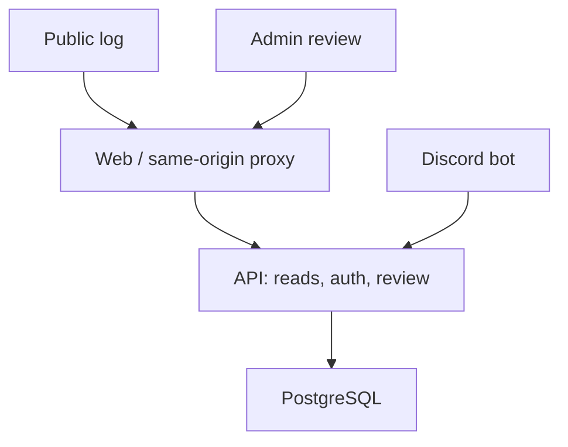

# Architecture

One TypeScript/npm-workspace repository and one PostgreSQL database keep the initial deployment small. The Discord bot is an adapter, not a second source of business rules or direct database writer. The API is the only planned submission/review writer.

## Boundaries

The web container serves static assets and proxies `/api/` to the API. The external reverse proxy terminates TLS. Public endpoints return only catalog data and approved collection credits; proof links, pending claims, Discord IDs and audit metadata remain private.

The bot connects outbound to Discord's gateway and the internal API. Submission writes use a dedicated service credential, restricted to bot routes. The credential must not authorize admin routes. Human admins use Discord OAuth, server-side sessions, a fixed redirect URL and an explicit ID allowlist. V1 does not require public visitors to log in.

Foundation API endpoints are `/healthz`, `/readyz` and `/api/v1/status`. Readiness checks that PostgreSQL is reachable and the migrated collection-state view exists; it does not indicate catalog/features are complete.

## Canonical identity

`items.id` is the stable canonical collection-log item identity, normally based on the source OSRS item ID. `game_item_ids` maps source variants/aliases to it when source evidence justifies equivalence. Never merge by display name alone.

`pages` describes the category and source page order. `page_items(page_id, item_id, slot)` supplies the many-to-many relationship and exact slot ordering. An item is stored once even when it occurs on multiple pages. All collection state is derived by canonical ID from approved submissions; no `collected` boolean is copied into page rows.

Initial schema: [001_initial.sql](../packages/database/migrations/001_initial.sql). The schema has no catalog seed or fake approvals.

| Entity                  | Main invariant                                                                       |
| ----------------------- | ------------------------------------------------------------------------------------ |
| `catalog_versions`      | Source URL/revision and import timestamp identify the checked-in snapshot            |
| `items`                 | Stable canonical item ID; soft deactivation preserves existing credits               |
| `game_item_ids`         | One source game item ID maps to exactly one canonical item                           |
| `pages` / `page_items`  | Ordered slots; one occurrence of a canonical item per page                           |
| `submissions`           | Unique Discord interaction ID; optional item while unmatched; approval requires item |
| `audit_events`          | Before/after review values and authenticated actor                                   |
| `collection_credits`    | Approved submissions only; all approved collectors retained                          |
| `item_collection_state` | Item collected iff at least one approved credit exists                               |

## Review transactions

An approval endpoint must authenticate an allowlisted admin, validate all fields, lock the submission and verify the client's expected version, resolve a real item, change status and insert an audit event in one transaction. Return 409 for stale/concurrent reviews. Increment `version` on every change. Record the actor from the session, never from a request body.

Rejecting a pending claim does not alter approved credits. Revoking an approval removes that credit from the derived public view. The item remains collected while another approved credit exists. Multiple legitimate collectors for the same item are allowed; Discord retries of the same interaction are not.

The foundation SQL enforces basic foreign keys/status checks/idempotency uniqueness. Auth, input checks, review state transitions and append-only audit permissions are implementation tasks; the schema alone is not a complete review service.

## Catalog updates

Create a reproducible import tool with a reviewed snapshot, source revisions, item mapping, category/page ordering, icon manifest and attribution. Use primary source data from the game/community-maintained source, and compare against reference client screenshots. The OSRS Wiki collection-log page is a candidate taxonomy source; its contents have not been imported or verified in this foundation.

Diff every import. Retain canonical IDs, carry approved credits forward, add new items as uncollected, deactivate removed entries rather than deleting history, and reject dangling or ambiguous mappings. Validate complete coverage against the selected revision. Sharing an item between pages is different from merging similarly named items.

## Operational policy

PostgreSQL is authoritative. Public reads may be cached with an ETag; approved/revoked writes invalidate that projection. Rate-limit bot writes and OAuth/review endpoints. Keep secrets and proof URLs out of logs. Use parameterized SQL, bounded request sizes, CSRF/origin validation on browser writes, secure session cookies behind TLS and escape names in the UI.

Back up database and deployment configuration, test restores, then add least-privilege database roles before V1. The foundation Compose uses one database owner for migrations/runtime to keep setup executable; separating migrator and runtime privileges is a tracked hardening requirement.
