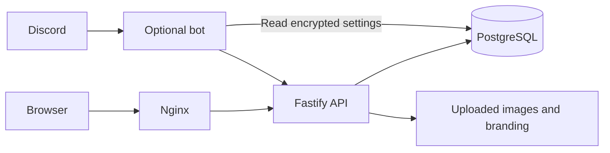

# Architecture

The `clan-clog` image runs PostgreSQL 17, Nginx, a Fastify API and an optional Discord bot in one container. A root supervisor initializes storage and PostgreSQL, then starts application processes as UID 1000 and PostgreSQL as UID 999. One persistent `/data` volume holds the installation. PostgreSQL listens only on loopback and a private Unix socket.

| Folder              | Responsibility                                                    |
| ------------------- | ----------------------------------------------------------------- |
| `apps/web`          | React/Vite public log and staff tools                             |
| `apps/api`          | Authentication, reads, intake, reviews, catalog and competitions  |
| `apps/bot`          | Discord commands and saved configuration; submissions use the API |
| `packages/domain`   | Shared validation, item identity, world modes and exact XP        |
| `packages/database` | Database setup, catalog import, permissions and maintenance       |
| `infra`             | Nginx, process supervisor, deployment and recovery                |
| `catalog`           | Pinned catalog inputs, identity mapping and asset provenance      |

PostgreSQL is authoritative. An item has one canonical ID across every page.
Approval grants Regular or Event credit. Normal-world items can have one Event
credit and independent Regular credits; the regular duplicate filter controls
Regular repeats in each world mode. Hardcore supports Regular only. Rejection
and revocation grant no credit. Claims, receipts and audits remain private.
Revisions prevent one staff edit from overwriting another. Request keys let
clients retry uncertain writes without creating a second submission or import.

Bootstrap initializes a fresh database with `001_baseline.sql`, applies pending
migrations, imports the catalog and provisions
`clog_runtime`. Only bootstrap/maintenance gets owner credentials. Startup
checks migration names and checksums; incompatible history fails before writes.
New migrations upgrade existing installations without recreating their data.
Databases with pre-release or incompatible migration checksums are unsupported.

Public reads use revision-based ETags and visibility-aware polling. Staff routes
load code and data together and clear private state on access loss. Production
builds exclude tests and fixture data. Item icons, fonts, UI art, logos and
uploads are served locally; the browser never fetches WOM results directly.

See [security](security.md), [contracts](contracts.md), [testing](local-testing.md)
and [recovery](release-recovery.md) for the operational boundaries.
