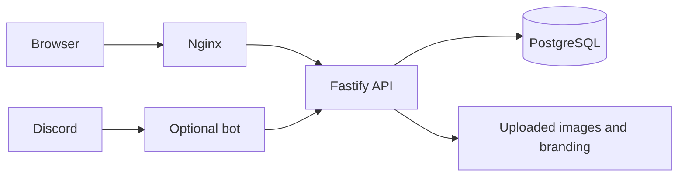

# Architecture

The site has two long-running containers: the application and PostgreSQL 17.
The application image, `clan-clog`, runs Nginx, a Fastify API and an optional
Discord bot. A short-lived `migrate` service uses that same image for setup.

| Folder              | Responsibility                                                   |
| ------------------- | ---------------------------------------------------------------- |
| `apps/web`          | React/Vite public log and staff tools                            |
| `apps/api`          | Authentication, reads, intake, reviews, catalog and competitions |
| `apps/bot`          | Discord commands; calls the API, never writes the DB             |
| `packages/domain`   | Shared validation, item identity, world modes and exact XP       |
| `packages/database` | Database setup, catalog import, permissions and maintenance      |
| `infra`             | Nginx, process supervisor, deployment and recovery               |
| `catalog`           | Pinned catalog inputs, identity mapping and asset provenance     |

PostgreSQL is authoritative. An item has one canonical ID across every page.
Approval grants one active credit per item per world mode; rejection and
revocation grant none. Claims, receipts and audit records remain private.
Revisions prevent one staff edit from overwriting another. Request keys let
clients retry uncertain writes without creating a second submission or import.

Bootstrap applies `001_baseline.sql`, imports the catalog and provisions
`clog_runtime`. Only bootstrap/maintenance gets owner credentials. Startup
checks migration names and checksums; incompatible history fails before writes.
Development databases from before this snapshot are unsupported.

Public reads use revision-based ETags and visibility-aware polling. Staff routes
load code and data together and clear private state on access loss. Production
builds exclude tests and fixture data. Item icons, fonts, UI art, logos and
uploads are served locally; the browser never fetches WOM results directly.

See [security](security.md), [contracts](contracts.md), [testing](local-testing.md)
and [recovery](release-recovery.md) for the operational boundaries.
