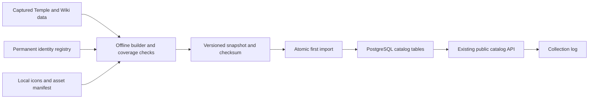

# Complete catalog import (CAT-01)

CAT-01 supplies the first production catalog: **1,717 canonical items, 124 pages, 1,864 ordered slots and five categories**, captured on 8 October 2026. It imports no collection credits. The 260-item frontend preview remains an explicitly labelled fixture with unrelated IDs.

## Source and coverage

[provenance.json](../catalog/provenance.json) records capture time, source URLs, exact SHA-256 hashes, the source revision, independent Wiki revision and expected coverage. The chosen taxonomy and slot order are TempleOSRS's [documented collection-log API](https://templeosrs.com/api_doc.php), not an assertion of pixel-perfect parity with a particular game client build.

| Input                                                 | Purpose                                                                                       | Pinned reference                                                                   |
| ----------------------------------------------------- | --------------------------------------------------------------------------------------------- | ---------------------------------------------------------------------------------- |
| [categories.json](../catalog/sources/categories.json) | Category/page order and exact game-ID slot arrays                                             | SHA-256 of captured API response                                                   |
| [items.json](../catalog/sources/items.json)           | Names and complete external ID set                                                            | SHA-256 of captured API response                                                   |
| [page-names.json](../catalog/sources/page-names.json) | Display labels extracted from the source page's `data-parameter` / `data-category` attributes | SHA-256 of the decoded label map                                                   |
| [wiki.json](../catalog/sources/wiki.json)             | Independent complete item-ID coverage check                                                   | OSRS Wiki Module:Collection log/data.json revision **15347607**, 17 September 2026 |
| [identities.json](../catalog/identities.json)         | Permanent game-ID to internal-ID registry                                                     | Reviewed, checked-in mapping; never regenerate existing IDs                        |
| [assets.json](../catalog/assets.json)                 | Every icon URL/hash/native dimensions, existing font/license/frame hashes                     | RuneLite commit **e9ebc4b41e765d09d1d91925c44e3103223e0430**                       |

The Temple source revision is the SHA-256 of the concatenated category, item and page-label bytes in that order. Temple's endpoints are mutable and do not expose immutable revisions, so the captured bytes are checked in. They are the rebuild input; builds and CI make no source requests. The Wiki response is independently pinned by its MediaWiki revision and file hash. Its sorted 1,717 IDs exactly equal Temple's item set.

| Category  |   Pages | Ordered slots |
| --------- | ------: | ------------: |
| Bosses    |      57 |           381 |
| Raids     |       3 |            67 |
| Clues     |      11 |           612 |
| Minigames |      22 |           261 |
| Other     |      31 |           543 |
| **Total** | **124** |     **1,864** |

An item can occupy slots on several pages. Thus 1,864 occurrences represent 1,717 distinct identities. Source-specific pages, including All Pets and shared treasure-trail rewards, remain intact. Coverage is against this captured source, not future game updates.

## Code and data flow



[catalog-model.ts](../packages/database/src/catalog-model.ts) defines and validates the import contract. It rejects malformed metadata, unsupported fields, external icon URLs, duplicate identities, ambiguous aliases, missing slot references and oversized inputs. Imported items must have external aliases; the shared domain validator also supports future manual items with an empty alias list. No import field can encode a collected flag or a submission.

[catalog-build.ts](../packages/database/src/catalog-build.ts) checks every pinned source hash, independent Wiki ID coverage, the complete identity registry, exact slot arrays and every local icon's hash, PNG header, alpha-channel format and 36 × 32 dimensions. It verifies the existing font/license/frame hashes. It then writes [snapshot.json](../catalog/snapshot.json) and its [semantic checksum](../catalog/snapshot.sha256). `--check` compares generated output with checked-in output without writing. Text supporting assets are hashed after CRLF-to-LF normalization; font/icon bytes and captured JSON are exact. Git attributes preserve catalog bytes across operating systems.

[catalog-import.ts](../packages/database/src/catalog-import.ts) checks the bundled checksum, validates again and imports within one PostgreSQL transaction. It uses the migration advisory lock to serialize first starts. Bulk parameterized inserts populate:

- `items`: stable internal IDs, display names, local icon paths and default active state.
- `game_item_ids`: unambiguous external aliases referencing canonical items.
- `pages`: source names, categories and source order within each category.
- `page_items`: ordered canonical memberships; array index becomes the zero-based slot.
- `catalog_versions`: semantic snapshot checksum as ID, source URL/revision and the database import timestamp.

There is no schema migration for this change: existing tables already support the model. Source retrieval time lives in the snapshot; database `imported_at` records when that installation imported it.

The initial registry allocates IDs **1,000,001–1,001,717**, independently of game IDs. Matching display names never merge variants; for example, separate Chompy bird hats retain separate identities. Repeated Virtus mask occurrences share one canonical ID. Future alias equivalence requires evidence and a reviewed registry change.

For [admin catalog work #30](https://github.com/KihiraLove/Vardorvis-clan-clog/issues/30), allocate new internal IDs with a collision-safe allocator and retain these existing IDs. Manual items do not require rows in `game_item_ids`. This importer can coexist with unrelated manual rows; any ID, alias or page conflict aborts atomically instead of overwriting them. An allocator and admin provenance/edit APIs remain #30 work.

## Run and repeat safely

```bash
npm ci
npm run build
npm run catalog:check
# Optional: reproduce the checked-in output offline, then review the diff.
npm run catalog:build

# Host-run database; export DATABASE_URL using your usual secret handling.
npm run db:migrate
npm run catalog:import
```

[bootstrap.ts](../packages/database/src/bootstrap.ts) runs migrations followed by the bundled import. Compose uses it for the existing one-shot `migrate` service before starting the API. The API image contains the snapshot/checksum; the web image contains its local assets. Image builds verify the source and asset bundle before packaging it.

On a fresh database, all 1,717 items are uncollected in both modes. Repeating the exact snapshot is a no-op and preserves credits, later manual corrections, additional items and page edits. The repeat is deliberately not a repair/reconciliation operation. A different snapshot for this source fails with an instruction to use a reviewed refresh workflow; it does not silently replace data. Reviewed additions/removals/overrides belong to the later catalog-refresh task.

A failed first import rolls back all its catalog rows; already-completed additive migrations remain applied. Resolve the conflict or restore the normal backup, then retry. Do not clear a production database to force an import. There is no deployment or rollback of live data in this PR.

Icons are checked in. To restore missing or changed files from immutable URLs and verify their expected hashes:

```bash
npm run catalog:assets
```

The downloader uses four workers and bounded retries for upstream throttling/server errors. `node scripts/catalog-assets.mjs --capture` is only for preparing a reviewed new asset manifest; ordinary rebuilds never refresh upstream data. Source updates require reviewing source bytes, coverage changes, existing identity retention and artwork changes together.

## Asset provenance and permissions

All 1,717 item icons are unmodified **36 × 32 RGBA PNGs**, obtained from immutable paths in [RuneLite's static asset repository](https://github.com/runelite/static.runelite.net/tree/e9ebc4b41e765d09d1d91925c44e3103223e0430/cache/item/icon). Per-file URLs and SHA-256 values are in the asset manifest. They retain transparency for silhouette outlines. RuneLite's distribution of these files does not transfer ownership of Jagex game artwork or make it MIT-licensed.

OSRS game names/artwork remain Jagex intellectual property. The project's noncommercial fan use is subject to the [Jagex Fan Content Policy](https://legal.jagex.com/docs/policies/fan-content-policy) and [fan/clan-site rules](https://legal.jagex.com/docs/rules/rules-of-runescape). The public footer attributes Jagex, TempleOSRS and the OSRS Wiki and links to the policy.

Temple's documented public API supplies factual item IDs, names and page memberships. No separate open-data license was located in its API documentation; this manifest does not claim one or relicense Temple software. The Wiki snapshot is attributed to the [OSRS Wiki contributors](https://oldschool.runescape.wiki/w/Module:Collection_log/data.json?oldid=15347607); Wiki textual content is available under its [CC BY-NC-SA 3.0 terms](https://oldschool.runescape.wiki/w/RuneScape:Copyrights). This copy is an unchanged API revision response used for coverage verification. Game media has separate Jagex rights.

The existing local scalable TrueType font comes from [evansloan/collectionlog.net](https://github.com/evansloan/collectionlog.net/blob/master/assets/fonts/runescape.ttf), Git blob `9d5c4f2140ff91c33f67c5ed0ca7712f84acbcab`. Its distributed [MIT notice](../apps/web/public/fonts/LICENSE.txt) is retained; game IP rights are distinct from that upstream software notice. A scalable font has no fixed raster dimensions.

The existing [panel.svg](../apps/web/public/ui/panel.svg) is repository-authored texture artwork at **128 × 128**, viewBox `0 0 128 128`. CSS constructs the surrounding UI. It is not an imported exact game frame. The [frontend reference](frontend-review/osrs-reference.png) is a **500 × 314** OSRS interface capture, documented in the [frontend review](frontend-review.md); final visual approval remains UI-01.

Created using intellectual property belonging to Jagex Limited under the terms of Jagex's Fan Content Policy. This content is not endorsed by or affiliated with Jagex.

## Verification

The database package tests full-source reproduction, exact slot order, stable shared mappings, distinct same-name variants, complete icon coverage, invalid aliases/references and prohibited credit fields. The real PostgreSQL test checks a late-conflict rollback, two simultaneous imports, zero initial credits, preserved manual items and later approvals, and refusal of changed snapshots. These tests require `TEST_DATABASE_URL` in CI and explicitly skip only PostgreSQL checks when that variable is absent locally.

CI's existing validation job now runs `catalog:check`. The Docker job boots the catalog and requests the real public catalog/collections routes plus a bundled icon. Existing browser tests continue to exercise the separate preview and public API contracts. Startup does not require a live Temple, Wiki or RuneLite connection.
