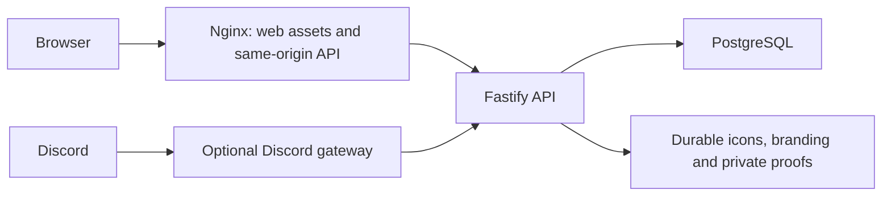

# Current architecture, operations and acceptance

This is the maintained inventory for the current remediation branch. Feature
guides below give detailed contracts; dated reviews, the project walkthrough and
ADRs describe the decisions at their recorded revisions. Implementation in draft
PR #105 is awaiting merge. Implementation does not imply production launch approval.

## Runtime and sources of truth

One application image runs Nginx, API and optional bot under a supervisor; a
separate PostgreSQL 17 container owns persisted state. A one-shot owner bootstrap
validates/migrates the schema, imports the pinned catalog and reconciles the
restricted runtime role before app startup. The bot calls the API and never
writes PostgreSQL directly. React/Vite assets use the same-origin proxy.

PostgreSQL owns canonical identities, independent ordinary/hardcore credits,
staff accounts/sessions, settings, catalog/scheduling revisions, competition
results, immutable receipts and audits. Uploaded assets use durable volumes;
private screenshot metadata and encrypted clan credentials require the matching
filesystem and encryption root on restore. Runtime images contain no test code:
see [packaging and OAuth retirement](runtime-packaging-and-auth-retirement.md).

## Implemented behavior and contracts

| Area                | Current behavior and detailed contract                                                                                                                                                                                                                                                                                       |
| ------------------- | ---------------------------------------------------------------------------------------------------------------------------------------------------------------------------------------------------------------------------------------------------------------------------------------------------------------------------- |
| Public log          | Canonical items share credit across pages; one active credit per item per mode. ETag projections, visible-page polling and exact activity boundary timers: [public performance](public-performance.md).                                                                                                                      |
| Staff access        | Individual password accounts, mandatory first change, server sessions, secure cookies, CSRF/origin checks and role restrictions. Central client session state clears private caches/drafts and cancels work on access loss: [backend/auth](backend-phase-one.md), [navigation](admin-navigation.md).                         |
| Browser policy      | Enforced same-origin scripts/styles/API, narrowly scoped local image previews and denied framing, with production-proxy header/browser checks: [CSP and framing](browser-security.md).                                                                                                                                       |
| Review              | Pending/reviewed queues, corrections, resolve, approve/reject/revoke, independently saved/discarded review notes and complete paged audits. Draft notes do not silently change claims: [review](integration-01-review.md), [pagination](review-pagination.md).                                                               |
| Intake              | Discord receipts and authenticated RuneLite uploads; world policy, duplicate mode credit and scheduling checks remain transactional: [bot](bot-intake.md), [RuneLite](runelite-submissions.md).                                                                                                                              |
| Catalog             | Imported and manual identities, durable validated icons, page/item management, revision-checked ordering and explicit source/manual reconciliation: [catalog](admin-catalog-backend.md), [reconciliation](import-reconciliation.md).                                                                                         |
| Competition imports | WOM metric metadata determines kind. Future/running SKILL imports are page-free metadata only; ACTIVITY may create a bounded page window. Finished SKILL results require an administrator and reconcile exact XP: [WOM](wom-competitions.md), [XP](xp-import.md).                                                            |
| Scheduling          | Default-disabled enforcement; staff manage overlapping windows, accepting an item when any associated active page is open: [scheduling](collection-log-scheduling.md).                                                                                                                                                       |
| Private history     | Review and XP histories use bounded, revision-bound keysets. Stale cursors require an explicit first-page reload, never silently joined snapshots: [review](review-pagination.md), [XP history](xp-history-pagination.md).                                                                                                   |
| Branding/settings   | Persisted administrator-managed labels, ordinary/hardcore branding and credentials; moderators retain only their allowed tools: [settings](site-customization.md), [branding](clan-branding.md).                                                                                                                             |
| Retention           | Explicit bounded preview expiry, dry-run-first abandoned-file cleanup and owner-only ended-event/window archival. Evidence, audit and receipt history stay preserved: [preview maintenance](deployment.md#expired-xp-and-competition-preview-maintenance), [assets](asset-maintenance.md), [archival](lifecycle-archive.md). |

The shared domain package defines validation/identity/XP rules. Route services use
narrow capability contracts; SQL locks, version checks and receipt replay remain
explicit in the owning stores. See [store and route contracts](store-and-route-contracts.md).
Admission, response size, concurrency and timeout ceilings are documented with
measurements in [workload budgets](workload-budgets.md).

## Startup and permissions

Use [environment setup](environment.md) and [deployment](deployment.md) as the
operator commands. Generate independent owner DB, runtime DB, session and first
administrator secrets; do not copy an example password. Authenticated fresh
startup requires `ADMIN_BOOTSTRAP_PASSWORD`; first sign-in changes it, then remove
the bootstrap value. Existing administrator credentials survive restart. Bot
gateway credentials are independent and optional; registration is explicit.
Production staff cookies require an HTTPS `PUBLIC_ORIGIN` and verified proxy trust.

Owner credentials are restricted to bootstrap/maintenance/backup operations.
The API uses `clog_runtime`, without DDL, ownership, arbitrary table access or
mutable receipt/audit grants. Bootstrap reconciles the complete privilege matrix
transactionally, including removal of retired OAuth grants. Do not run destructive
integration tests on a live cluster. See [OPS handover](ops-01.md).

The current schema is immutable SQL `001_baseline.sql` through
`022_submission_duplicate_filters.sql`. A complete checksummed prefix may upgrade; changed,
missing, future or unknown ledger entries fail closed. Repeated exact startup is
supported. Image rollback requires the identical applied schema manifest and
compatible application/catalog contracts. A pre-022 image cannot run against a
022 ledger. There is no automatic schema downgrade. The original nine development
migrations are not an accepted upgrade prefix of the consolidated baseline;
recover/rehearse a matching installation before any intentional migration.

## Readiness, shutdown and recovery

`/healthz` is process liveness. Public `/readyz` requires the API accepting work
and a successful DB probe. Optional gateway outage affects
`/api/v1/discord/status`, while the website remains available. The supervisor
restarts a failed bot with capped backoff; API or proxy exit fails the app.
Shutdown drains bot interactions, then API handlers/responses, then Nginx inside
the 70-second Compose window. Uncertain COMMIT/acknowledgement outcomes retain
their original receipt identities. See [runtime operations](runtime-operations.md).

The versioned launcher pins application/PostgreSQL digests and verified
infrastructure with an authoritative atomic release record. Backups coordinate
database plus both asset volumes, secrets/encryption root and release identity.
The isolated restore job verifies all database tables/files, restored credentials,
private proof and decryption in a fresh namespace. It rejects incomplete/corrupt
backups, reused namespaces and incompatible images. See [release recovery](release-recovery.md)
and the [021 compatibility matrix](runtime-packaging-and-auth-retirement.md).

## Automated inventory and evidence

Run `node scripts/check-local.mjs` with Node 24 and Linux Docker. It needs no host
npm installation, production `.env` or hosted runner. The maintained gate includes:

- Script tests for runner isolation, backup/recovery, runtime packaging and cleanup.
- Formatting, lint, clean workspace builds, catalog verification, typechecks and
  relative documentation links.
- Domain/API/bot/web/database Node tests with real disposable PostgreSQL, including
  grants, populated upgrades, concurrency, rollback and exact receipt replay.
- Chromium browser scenarios for public/staff UI, desktop/320px navigation,
  keyboard/touch, access loss, drafts and failures; many API responses are fixtures.
- Chromium/Firefox/WebKit workflows through disposable HTTPS, production Nginx/API
  and PostgreSQL, with real staff sessions, private proof and canonical credit/revoke.
  JSON report checks require normal single-attempt passes and all original audit cases.
- Production-build loading/byte-budget checks, cold code/data overlap, chunk failure
  recovery and isolated demo loading, plus workload/public-projection measurements
  with real SQL and large ledgers.
- Built-image inspection before test injection, then actual production proxy/API/
  database smoke, durable assets, maintenance, restarts, shutdown/readiness and
  complete isolated backup/restore and deployment failure scenarios.

Use the latest `.data/local-checks/<run-id>/result.json` and its validation,
browser, `runtime-image.json`, measurement and recovery reports for counts and
the tested revision. Counts are generated evidence, not a permanent feature
claim. A full pass rejects skipped/TODO workspace tests; record a clean exact
commit because release bundles embed its identity. Focused tests may explicitly
skip database tests without `TEST_DATABASE_URL`; that is not full acceptance.
[Local testing](local-testing.md) describes artifacts, scoped cleanup and release-only CI.

## Remaining launch acceptance

The remaining manual release acceptance is tracked by #104. Its
[automated gates and manual launch checklist](release-acceptance.md) require
fresh dependency evidence, named database/retry regressions, all browser reports
and complete recovery evidence. The consolidated report explicitly keeps live
guild/host/device checks pending; the operator will perform them manually.
[Public/admin/demo entry
splitting](frontend-loading.md) keeps staff screens and sample fixtures out of the
initial public graph, coordinates code/data preparation and measures readiness.
Production proxy/browser [CSP and framing acceptance](browser-security.md) is implemented (#102).
[Real HTTPS browser acceptance](browser-acceptance.md) adds Chromium, Firefox and
WebKit workflows through the production proxy/API/PostgreSQL, genuine secure
sessions, private PNGs, canonical public credit/revoke, role/access loss, delayed
reads and logo uploads (#103). Fixture suites retain targeted failure/layout
coverage. The full gate rejects skips, expected failures and retries in all four
browser reports and requires all ten original audit scenarios.

Preview mode intentionally remains an explicit `?preview=1` sample ledger, loaded
only on demand in a separate chunk. It is isolated from persisted clan data and
grants no server access; [the loading guide](frontend-loading.md) records that policy. Existing local gateway fixtures do not
replace a real test-guild command/receipt exercise. Actual host DNS/TLS, hardware
load/capacity, supported release/dependency sign-off, off-host recovery, a real
published prior-release rehearsal and final cutover remain release gates (#104).
No local green run claims those external checks passed.
