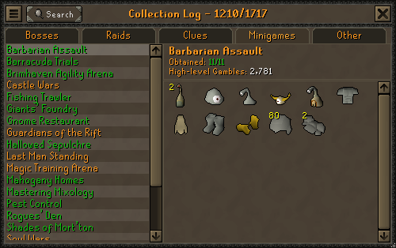

# Collection-log frontend review

Status: first frontend slice, 2026-10-05. UI-01 [#3](https://github.com/KihiraLove/Vardorvis-clan-clog/issues/3) and UI-02 [#9](https://github.com/KihiraLove/Vardorvis-clan-clog/issues/9) are assigned to KihiraLove and remain open for manual review. This work is on a feature branch/draft PR, not merged to main.

## Run and inspect

```bash
npm ci
npm run build -w @clog/domain
npm run dev:web
```

Open `http://127.0.0.1:5173/?preview=1`. This explicit preview contains 13 selected pages and 260 unique sample items with locally served icons. It is not a complete catalog, and its numeric IDs are fixture identities, not production OSRS IDs. The default scenario has no credits. Changing the review selector to ordinary/mixed hardcore examples never writes clan data; reload resets to all uncollected.

Review Vardorvis, then Duke Sucellus/The Leviathan/The Whisperer: Virtus mask is shared across these pages. In the ordinary example it is collected; in the mixed example it has the red border and the menu contains both a normal line and a hardcore line with the skull and suffix. Changing back to ordinary removes hardcore styling while retaining collection; changing back to all uncollected removes the remaining example credit.

Use all five tabs, scroll longer pages, open Search to filter the active category's pages, and use Native 1× for the game-window proportions or Larger 1.5× for reading. Tab arrows/Home/End switch categories. Hover/focus/tap items; move the pointer into a menu, press Escape or tap outside to dismiss it. On narrow screens the frame retains its proportions inside a horizontal scroll area, while menus stay inside the viewport.

At `/` the frontend requests real public read endpoints. The current foundation returns unavailable errors, which are shown honestly with an optional preview button. Preview data is never silently substituted for live data. API polling uses independent ETags every 25 seconds while visible, refreshes on tab return, and retains the last successful data after a failed refresh.

## Review captures

The browser suite saves native-uncollected, hardcore-desktop and hardcore-mobile PNG captures in its test-results directory. The PR's CI run uploads these as the `frontend-browser-review` artifact alongside any failure traces. Download that artifact from the Actions run for manual review; they are current implementation captures, not approved pixel-perfect acceptance baselines.

Reference frame used for proportions and visual comparison:



The [OSRS Wiki interface screenshot](https://oldschool.runescape.wiki/w/File:Collection_log_interface.png) was retrieved on 2026-10-05 at 500 × 314 pixels. Compare frame trim, tab shapes, font rasterization, page rows, icon spacing and scrollbar details during manual review; those details still require final approval. The current CSS reimplements the frame; it is not a flattened screenshot overlay.

## Source assets

Sample page definitions/icons were captured from [Collection log revision 15356324](https://oldschool.runescape.wiki/w/Collection_log?oldid=15356324). The [asset manifest](../apps/web/public/preview/provenance.json) records source URLs and SHA-256 values. Identical known shared drops in this curated fixture use one internal ID. This fixture builder is not a production name-merging rule or full catalog importer.

Item images/reference capture are OSRS game media, copyright Jagex. The RuneScape font was obtained from [evansloan/collectionlog.net](https://github.com/evansloan/collectionlog.net/blob/master/assets/fonts/runescape.ttf), source blob `9d5c4f2140ff91c33f67c5ed0ca7712f84acbcab`; the distributed [MIT notice](../apps/web/public/fonts/LICENSE.txt) is retained. The panel texture and mini-menu skull are local SVG/CSS work. Runtime rendering does not fetch Wiki assets or use a CDN.

## Validation and remaining work

```bash
npm run validate
npx playwright install chromium
npm run test:e2e -w @clog/web
```

The browser suite covers navigation/geometry, all sample icons, shared/HC state, hover/focus/touch/Escape, viewport bounds and mocked live refresh/failure/revocation. CI also runs PostgreSQL and Docker smoke checks, plus the new Chromium job. Browser failure artifacts contain only fixture/mocked public data.

Remaining acceptance: a complete reviewed catalog/assets (#1), implemented public snapshots (#2), final in-game screenshot/pixel approval (#3), real review-to-public behavior and hardware/mobile acceptance (#7/#9/#12), and backend/admin/bot hardcore persistence (#26). Admin review/catalog maintenance and XP pages remain later frontend work (#8/#28/#31). No issue is closed and no auto-closing PR keywords are used.
