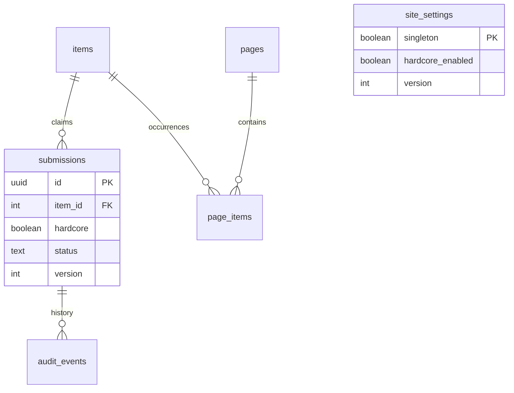

> **Historical record:** This document preserves decisions/review evidence at its recorded revision. Current topology, authentication, implemented features and acceptance are maintained in the [current inventory](current-state.md); older pending-feature statements below are superseded.

> **11 October 2026 update:** The supplied `clan-logo.png` is now the default; administrators can upload animated replacements. Branding labels and admin settings navigation are configurable as described in [site customization](site-customization.md). Earlier visual notes below are historical.

> **Release update:** Schema 002 is now part of the consolidated fresh-install [baseline](../packages/database/migrations/001_baseline.sql).

# Mockup revision: collection log and SOTW tracker

> **8 October 2026 backend update:** [Backend phase 1](backend-phase-one.md) now implements public catalog/collection reads, Discord sessions and authenticated persistent settings. Statements below describing those services as pending are historical; intake/review, WOM and catalog import remain pending.

This document records the owner's 7 October 2026 mockup and requests. It supersedes conflicting display and collection rules in earlier review notes. The [project guide](project-guide.md) explains the full code, data model, architecture and CI pipeline.

## Requested behavior and implementation

| Area                | Current implementation                                                                                                                                                       |
| ------------------- | ---------------------------------------------------------------------------------------------------------------------------------------------------------------------------- |
| Homepage            | Animated supplied Mexicat GIF, a 2× collection log, BOTW caption, then the SOTW event tracker. No public Admin button.                                                       |
| Branding            | Original GIF preserved, skull asset copied, favicon generated from GIF frame zero. See the brand folder's provenance note.                                                   |
| Collection size     | Native 500 × 314 log rendered at 1000 × 628. Narrow screens scroll inside the log container.                                                                                 |
| Item rendering      | Browser image smoothing. This is not a RuneLite xBR shader implementation.                                                                                                   |
| Uncollected items   | Dim icons; no hover, focus or tap menu.                                                                                                                                      |
| Normal and hardcore | Independent credits, counts and collector information over the same catalog. The skull switches mode and turns red while active.                                             |
| Hardcore outline    | SVG alpha dilation generates a red contour around the icon silhouette, without a red slot border.                                                                            |
| Release switch      | Hidden by default. Admin settings enable/disable the skull. Disabling returns the public UI to normal and preserves HC records. No automatic release date.                   |
| One collection      | At most one approved credit per canonical item **per world mode**. Pending/rejected/revoked claims can remain in history. Revocation frees that mode for corrected approval. |
| XP sidebar          | Total stays above a separately scrollable list of imported events. Selecting an event shows its gains and WOM link.                                                          |
| Skill scope         | Each event covers one skill or all 24 tracked skills. Unrelated skills show zero for a single-skill event.                                                                   |
| XP amounts          | Million labels fit four integer digits plus decimals and m. Hover, keyboard focus and touch expose exact XP. Total gained appears below the skills.                          |
| Admin location      | Open `/admin` directly, e.g. https://daybloom.net/admin. XP imports are at `/admin/xp`. Nginx already supports SPA paths; domain/DNS deployment is separate.                 |

The one-credit rule is interpreted independently for normal and hardcore so both logs can collect the same item. The release flag controls public visibility, not deletion or admin review of historical HC claims.

## Preview versus live operation

Presentation and interaction changes work with the shared, explicitly labelled in-memory preview. Reloading resets settings, submissions, imports and catalog edits. Preview never writes clan data.

The live Fastify service now reads the public release setting from PostgreSQL. Migration 002 adds durable storage, the HC column, independent projections and uniqueness enforcement. The repository still lacks the previously planned OAuth/session, collection/catalog, transactional review and WOM import services. Authenticated settings writes and the new XP aggregate endpoint have frontend adapters and documented contracts but are not implemented production server routes. These dependencies remain open in GitHub.

## Code paths

- [App.tsx](../apps/web/src/App.tsx) owns navigation, adapter lifetimes, branding, release-gated skull and SVG contour filter. Both `/` and legacy `/xp` show the unified public page.
- [CollectionLog.tsx](../apps/web/src/CollectionLog.tsx) filters credits by mode before calculating counts or opening menus. Mode changes close an open menu.
- [model.ts](../apps/web/src/model.ts) rejects duplicate active item/mode credits and exposes `modeCredits`. The shared domain projection limits legacy duplicate display; the database and write API enforce uniqueness.
- [AdminSettings.tsx](../apps/web/src/AdminSettings.tsx) reads only after an admin session exists, saves with an expected revision, handles access loss/timeouts and reloads conflicts without repeating writes.
- [site-settings.ts](../apps/web/src/site-settings.ts) validates settings. [admin-api.ts](../apps/web/src/admin-api.ts) adds authenticated no-store reads and CSRF-protected writes to the existing adapter.
- [preview/admin.ts](../apps/web/src/preview/admin.ts) stores the flag and prevents duplicate approvals or approved edits into an occupied mode. Settings notifications preserve unrelated submission pagination.
- [XpPage.tsx](../apps/web/src/XpPage.tsx) loads one coherent tracker snapshot, selects Total or an event locally, polls while visible and retains successful data on refresh failure.
- [xp-tracker.ts](../apps/web/src/xp-tracker.ts) validates event IDs, WOM links, one/all skill scope and decimal-string gains; projects event skills and sums with `BigInt`.
- [xp-api.ts](../apps/web/src/xp-api.ts) adds conditional tracker reads, committing ETags only after validation. Older detailed adapters remain available but are no longer used by the public page.
- [XpAdmin.tsx](../apps/web/src/XpAdmin.tsx) keeps guarded preview/apply but presents event/skill/gain information without participant tables. Internal import payloads still contain participant snapshots for reconciliation; public tracker payloads do not.
- [style.css](../apps/web/src/style.css) contains the mockup layout, fixed 2× geometry, silhouette styling and responsive event grid.
- [002_world_modes.sql](../packages/database/migrations/001_baseline.sql) evolves the schema without changing migration 001's checksum.

## Data model changes



Migration 002 sets existing claims to normal. A partial unique index on `(item_id, hardcore) WHERE status = 'approved'` permits one normal and one HC credit for an item, including under concurrent writes. Pending duplicates remain reviewable.

`collection_credits` adds `hardcore`. `item_collection_state` exposes normal `collected` and independent `hardcore_collected`. Page membership stays shared: approval updates every occurrence in its mode and counts once globally.

The singleton `site_settings` row defaults `hardcore_enabled` to false and `version` to 1. Future authenticated writes must compare/advance the version atomically and audit the actor/change. SQL does not implement review or settings services.

If existing data has multiple approved normal claims for one item, migration 002 intentionally fails. Reconcile them through an explicit audited correction before retrying; the migration never silently chooses or deletes a collector. Pending migrations roll back together on failure.

## HTTP contracts

Implemented public route: `GET /api/v1/settings`, with `Cache-Control: no-store`:

```json
{ "revision": "settings-1", "hardcoreEnabled": false }
```

Database/read failure returns 503. The browser hides the skull and returns to normal on failure. It polls every 25 seconds while visible and refreshes on returning to the tab.

Planned authenticated routes: `GET /api/v1/admin/settings` and `PUT /api/v1/admin/settings`. PUT sends same-origin credentials, `X-CSRF-Token` and JSON:

```json
{ "hardcoreEnabled": true, "expectedRevision": "settings-1" }
```

Return saved settings with an advanced revision; 401/403 for lost access and 409 for stale revision. Server responsibilities include role checks, session/CSRF enforcement, atomic writes and durable audit.

Planned public XP route: `GET /api/v1/xp/tracker`. One revision covers totals and events:

```ts
interface XpTracker {
  revision: string;
  totals: Record<SkillId, string>; // All 24, nonnegative decimal integers.
  events: Array<{
    id: number; // Stable WOM competition ID.
    title: string;
    sourceUrl: string; // Canonical WOM URL matching id.
    skills: SkillId[]; // Exactly one skill or all 24, no duplicates.
    gains: Partial<Record<SkillId, string | null>>; // Every scoped skill.
  }>;
}
```

Event gains are clan-wide contributions during the event, not lifetime player XP. Imports reconcile by stable event ID: refreshing replaces the contribution instead of adding it twice. Internal participant snapshots can support reconciliation without appearing publicly. Null means unavailable; zero means known zero. An event total containing unavailable gains remains unavailable. Cumulative totals currently require known nonnegative strings.

## Review locally

1. Start the web server and open `/?preview=1`: uncollected log, hidden skull and XP below.
2. Open `/admin?preview=1` directly, enable hardcore worlds and save. Use the brand link to return without resetting preview state.
3. Expand public preview controls and select Mixed hardcore credits. Compare normal/HC counts, dates and contours. Uncollected icons must never open menus.
4. Use browser Back to disable HC and save. Return through the brand: the skull disappears. Re-enabling preserves HC records.
5. Expand XP preview controls and Show sample XP. Select Total, Attack and the all-skill event. Verify exact tooltips, links and totals. Re-adding samples must not double-count.
6. Open `/admin/xp?preview=1` for fixture imports and review corrections before applying. A full page reload resets the preview.

## Verification and issue alignment

Browser coverage checks desktop/320-pixel touch layouts, hidden public Admin navigation, branding, 2× dimensions, empty-item behavior, release toggles, independent HC credit/contours, event selection, exact XP, sidebar scrolling, duplicate imports and existing review/catalog flows. Unit tests cover credit uniqueness, settings revisions, aggregate parsing and cache validation. PostgreSQL integration checks default-off settings, independent projections and duplicate approval rejection; it requires `TEST_DATABASE_URL`.

CI behavior is unchanged: format/lint/build/typecheck/unit/database validation, Docker smoke and Chromium browser jobs gate main-branch image publishing. Browser tests use dedicated port 5187 with strict binding and no reuse of an unrelated server.

Updated acceptance: [UI-01 #3](https://github.com/KihiraLove/Vardorvis-clan-clog/issues/3), [UI-02 #9](https://github.com/KihiraLove/Vardorvis-clan-clog/issues/9), [HC #26](https://github.com/KihiraLove/Vardorvis-clan-clog/issues/26), [XP backend #27](https://github.com/KihiraLove/Vardorvis-clan-clog/issues/27), [XP UI #28](https://github.com/KihiraLove/Vardorvis-clan-clog/issues/28), plus API/auth/intake/bot/review/admin/QA/product/epic issues #2, #4, #5, #6, #7, #8, #12, #14 and #15. Earlier notes remain as history where replaced. Issues remain open for backend work and review.

### Local validation results

The completed revision passed all 20 Chromium browser scenarios and 49 Node tests. One PostgreSQL integration test was explicitly skipped because TEST_DATABASE_URL was not configured. All workspace TypeScript builds/typechecks, the production web build, ESLint, Prettier and documentation-link checks passed. Desktop and 320-pixel screenshots were inspected. Docker/PostgreSQL integration and production deployment were not run locally.
