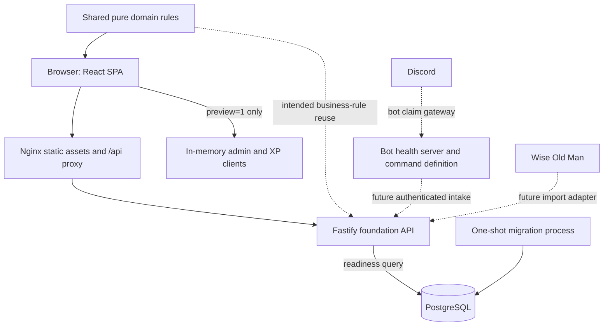
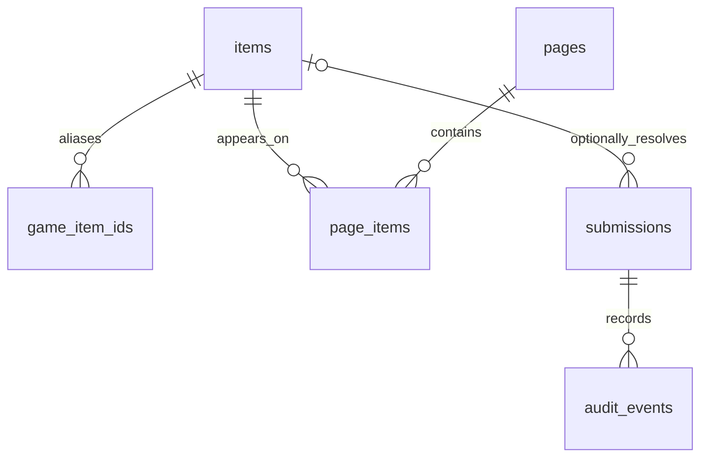
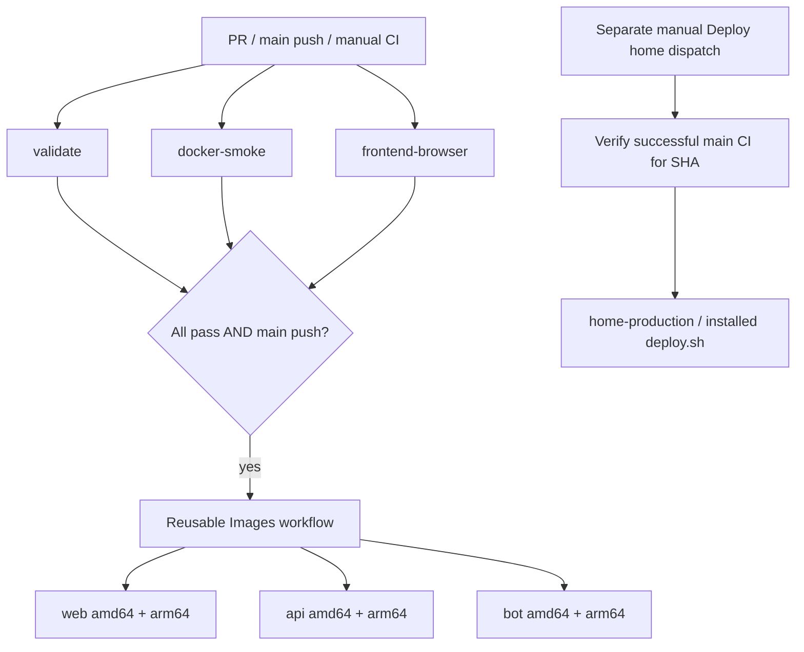

> **10 October 2026 release update:** The development migration series has been squashed to a fresh-install [001_baseline.sql](../packages/database/migrations/001_baseline.sql), and web/API/bot now ship in one application image. The detailed sections below are historical snapshots; use [deployment](deployment.md) for release procedures.

# Project code, data model, architecture and CI guide

> **8 October 2026 CAT-02 update:** [Admin catalog backend](admin-catalog-backend.md) implements authenticated creation, durable PNG icons, revision-checked ordering and explicit alias reconciliation. Compose now includes an icon volume, and backups include both database and icons. Earlier descriptions of those features as pending are superseded.

> **8 October 2026 CAT-01 update:** [Complete catalog import](catalog-import.md) now supplies 1,717 items, 124 ordered pages and verified local icons. Compose initializes the catalog after migrations; earlier descriptions of catalog import as pending are superseded.

> **8 October 2026 backend update:** [Backend phase 1](backend-phase-one.md) now implements public catalog/collection reads, Discord sessions and authenticated persistent settings. Statements below describing those services as pending are historical; intake/review, WOM and catalog import remain pending.

This guide describes the checked-in implementation reviewed on 7 October 2026. It explains the source files and their interactions, including the boundary between working frontend previews and future production services. Inline comments in the source explain the responsibilities and less obvious decisions. JSON configuration, binary assets and the checksummed SQL migration are explained here without changing their contents.

The owner’s mockup revision is implemented in the frontend and described in [mockup revision](mockup-revision.md), including explicit live-backend boundaries.

## 1. What works today

The repository is a TypeScript npm-workspace monorepo for an Old School RuneScape clan collection log. React renders the public log, submission review, catalog maintenance and competition XP interfaces. A Fastify service and PostgreSQL schema establish the backend foundation. A Discord command is defined, but the bot process currently runs only a health server.

| Area                      | Implemented behavior                                                                                                               | Remaining production work                                                            |
| ------------------------- | ---------------------------------------------------------------------------------------------------------------------------------- | ------------------------------------------------------------------------------------ |
| Public collection log     | Five categories, 2× layout, collected-item menus, independent normal/HC progress, default-off release switch and explicit previews | Catalog import, complete assets, public catalog/credit routes                        |
| Submission administration | Session-aware UI, paged review, corrections, proof checks, decisions, audit display and in-memory simulator                        | Password/session enforcement, intake, transactional review and durable audits        |
| Catalog administration    | Icon validation, creation UI, multiple page memberships, accessible ordering and simulated concurrency                             | Icon storage, allocation, versioning, source/manual overlay and backend routes       |
| XP                        | Inline event sidebar, exact per-event/overall totals, preview/apply/history UI and two simulated competitions                      | WOM adapter, import reconciliation, database tables and endpoints                    |
| Runtime                   | Health/status/readiness, public settings read, migrations, images, Compose and CI workflows                                        | Real feature acceptance, operational recovery rehearsal and production configuration |

An HTTP adapter is a client of an intended contract; its existence does not mean the server implements that route. Opening the live frontend against this API produces explicit unavailable states. Adding `?preview=1` selects local sample clients. Reloading or leaving preview mode loses the simulated state.

## 2. Architecture and ownership



Solid runtime paths exist today; dashed paths mark planned integration. The API declares a domain dependency but currently implements only a public settings reader beyond foundation routes. The bot likewise has no direct database writes or running Discord client. PostgreSQL is intended to be authoritative once the feature services are implemented; preview maps are disposable browser memory.

Production request routing is browser → external TLS reverse proxy → loopback-bound web container → API for `/api/` paths. Nginx serves other paths as static files, falling back to `index.html` for SPA routes. Vite provides an equivalent `/api` proxy in host development. Public TLS termination is outside the checked-in Compose stack.

| Workspace           | Technology                   | Responsibility                                                               |
| ------------------- | ---------------------------- | ---------------------------------------------------------------------------- |
| `apps/web`          | React 19, Vite 7, TypeScript | Presentation, client-side input checks, HTTP adapters and preview simulators |
| `apps/api`          | Fastify 5, `pg`              | Health/readiness/status and settings read; planned sole feature writer       |
| `apps/bot`          | Node HTTP, discord.js 14     | Current scaffold health service and slash-command description                |
| `packages/domain`   | Pure TypeScript              | Canonical identity, approval projection, proof and date validation           |
| `packages/database` | PostgreSQL 17, `pg`          | SQL schema, forward migrations and database integration test                 |

Version families above come from repository manifests and image configuration, not a claim about the latest upstream releases. Exact installed dependency versions are recorded in `package-lock.json`.

### Browser composition

[App.tsx](../apps/web/src/App.tsx) interprets `/`, `/xp`, `/admin`, `/admin/catalog` and `/admin/xp` without a routing library. It intercepts ordinary internal link clicks with `pushState`, listens for browser `popstate`, and preserves modified clicks for normal browser behavior. Preview selection lives in the URL query string.

The app memoizes its admin client by mode, so navigating between admin and public pages preserves the same simulated ledger. `useSyncExternalStore` subscribes the public preview to its revision counter. The XP preview has its own ledger and consults the shared admin client's session for the admin UI. These clients are not browser storage: they do not use localStorage, IndexedDB or a backend. Preview icon blob URLs are revoked when the client is disposed.

Models and parsers sit between untrusted JSON and React components. The live and preview clients implement the same interfaces, letting UI behavior be exercised before backend routes exist. Browser validation improves feedback and catches malformed responses; future servers must independently authenticate, authorize and validate every write.

## 3. Persistent data model

The schema is defined by [001_initial.sql](../packages/database/migrations/001_baseline.sql) and [002_world_modes.sql](../packages/database/migrations/001_baseline.sql). Migration 002 adds the hardcore claim column, per-mode approval uniqueness and default-off site settings. There is no seed catalog or XP persistence yet. The runner additionally creates `schema_migrations`.



`site_settings`, `catalog_versions` and `schema_migrations` are standalone metadata tables; neither is linked by a foreign key to catalog rows. Collection views are derived queries, not separate writable entities.

| Table               | Fields and keys                                                                                                                                                                             | Meaning and enforced invariants                                                                                                                                                               |
| ------------------- | ------------------------------------------------------------------------------------------------------------------------------------------------------------------------------------------- | --------------------------------------------------------------------------------------------------------------------------------------------------------------------------------------------- |
| `schema_migrations` | `name` PK, `checksum`, `applied_at`                                                                                                                                                         | Runner-owned SHA-256 ledger; changed bytes in an applied SQL file cause migration failure                                                                                                     |
| `catalog_versions`  | Text `id` PK, `source_url`, `source_revision`, `imported_at`                                                                                                                                | Source/import metadata; the initial schema does not attach a version to individual items/pages                                                                                                |
| `items`             | Positive integer `id` PK, nonblank `name`, nullable `icon_path`, `active` default true                                                                                                      | One stable canonical item; soft deactivation is available, but the current collection view does not filter by `active`                                                                        |
| `game_item_ids`     | Positive `game_item_id` PK, required `item_id` FK                                                                                                                                           | Every stored external OSRS ID maps to exactly one canonical item; many aliases may map to one item                                                                                            |
| `pages`             | Text `id` PK, `category`, `name`, nonnegative `sort_order`                                                                                                                                  | Page identity and source ordering; SQL does not restrict category to the browser's five values or make `sort_order` unique                                                                    |
| `page_items`        | PK `(page_id, item_id)`, both FKs, nonnegative `slot`, unique `(page_id, slot)`                                                                                                             | Many-to-many placement with one occurrence per page and no two items in one slot; different pages may share an item                                                                           |
| `submissions`       | UUID `id` PK, unique `discord_interaction_id`, Discord user/guild IDs, raw text, nullable item FK, collector/date/proof, `hardcore` default false, status/review fields, positive `version` | Claims can be unmatched while pending. Approval requires an item. Every nonpending state requires reviewer and review timestamp. Rejection/revocation additionally requires a nonblank reason |
| `audit_events`      | Generated bigint `id` PK, submission FK, actor Discord ID, allowed action, JSONB old/new values, timestamp                                                                                  | Submission-specific history; allowed actions are `resolve`, `edit`, `approve`, `reject`, `revoke`. SQL does not automatically create events or enforce append-only access                     |

Submission text constraints bound raw item text to 1–200 trimmed characters, collector name to 1–80 trimmed characters and proof URL length to 1–2048. The SQL proof constraint checks length only; host/protocol validation belongs in application rules. `collected_on` is a calendar `date`, while submission/review/audit timestamps use `timestamptz`.

The queue index `(status, submitted_at)` supports review filtering. The partial index on `(item_id, collected_on) WHERE status = 'approved'` supports approved-credit lookups. Foreign keys preserve references; this schema declares no cascading deletes.

### Derived collection state

`collection_credits` selects approved submissions with submission ID, canonical item ID, collector/date and hardcore mode. `item_collection_state` exposes independent `collected` (normal) and `hardcore_collected` projections. A partial unique index allows only one approved claim per `(item_id, hardcore)`. Neither view stores a page-occurrence boolean.

If item 42 appears on two boss pages, one normal approval collects both normal occurrences and counts once globally. HC occurrences remain uncollected until independently approved. Revoking the sole credit uncollects its mode. `collectionState` supports mode filtering and deterministically limits legacy duplicate display to the earliest credit; parsers, preview writes and SQL enforce the new unique-credit rule.

The `site_settings` singleton stores `hardcore_enabled` (false initially) and a positive version. The public API reads it from PostgreSQL; the admin UI and adapters support revision-checked edits, but authenticated server writes still require the pending auth/settings service. Disabling visibility preserves recorded HC credits. Migration 002 fails on existing duplicate approvals instead of discarding data.

### Site settings

`site_settings` has a singleton boolean primary key constrained to true, `hardcore_enabled` default false and a positive version default 1. It has no foreign keys. Admin writes must atomically compare/advance this version and audit the change when the authenticated backend is implemented.

### Migration algorithm

[migrate.ts](../packages/database/src/migrate.ts) opens a PostgreSQL client, begins one transaction and obtains transaction-scoped advisory lock `74261005`. It creates the migration ledger if needed, selects files matching a numbered SQL filename, sorts filenames lexically, and hashes their UTF-8 contents. Use consistently padded numeric filenames to preserve the intended order.

For an existing ledger entry, the checksum must match. For a new file, the runner executes its SQL and inserts the checksum in the same transaction. All pending migrations commit together; a failure rolls the transaction back and the connection closes. Direct execution requires `DATABASE_URL`; importing `migrate()` does not run the CLI path.

Do not edit `001_initial.sql`, even to add explanations: comments alter its checksum. Add forward migrations for new fields and tables. The comments added during this review deliberately leave that file unchanged.

## 4. Frontend data contracts

### Collection log

[model.ts](../apps/web/src/model.ts) defines `Catalog { revision, items, pages }`, where each page has ordered canonical `itemIds`, and `Collections { revision, credits }`. Public item data contains an icon path and display name, without requiring external game IDs.

`parseCatalog` checks nonblank text, positive safe integer IDs, duplicate identities, known categories, valid page references and same-origin icon paths. `parseCollections` discards explicitly nonapproved rows, validates calendar dates, unique submission IDs and unique item/mode credits, and defaults an omitted hardcore value to false. An omitted credit status is accepted as approved for the public contract. `validateLog` rejects credits for missing catalog items.

[PublicLogClient](../apps/web/src/api.ts) fetches catalog and collection responses concurrently. Each resource has its own ETag; a 304 reuses its existing cached value. Both caches advance only after the pair passes validation and the request has not been aborted. Catalog and collection revision strings are independent; this client does not require them to be equal.

`usePublicLog` loads immediately, polls every 25 seconds while visible, reloads on returning to the tab, and provides manual retry. Requests time out after 10 seconds. Failed refreshes retain the last successful data and display an error instead of substituting sample credits.

### Submission and catalog administration

[admin-model.ts](../apps/web/src/admin-model.ts) defines the `AdminClient` contract, submission/audit shapes, catalog provenance, page versions and icon staging receipts. Its parsers reject malformed private responses, queue rows outside the requested status view, and audit snapshots for a different submission.

The queue has three views: pending, unmatched pending, and reviewed. Live requests ask for 20 rows; the preview uses two to demonstrate pagination. The UI keeps a stack of cursors for backward navigation and prevents acting on a retained snapshot belonging to a different view/page.

`SubmissionEditor` separates draft corrections from saved claims. Approval requires a saved canonical item, a valid proof link and acknowledgment of that saved claim. Editing clears the acknowledgment. Approved-credit corrections, rejections and revocations require reasons. Writes include `expectedVersion`; the live client verifies returned identity, an advanced version and the expected decision status. A 409 can reload current data, but it never automatically repeats the decision.

`LiveAdminClient` sends same-origin credentials, disables private-response caching and supplies `X-CSRF-Token` on writes. Actor identity is not submitted by the browser. Catalog creation also includes an `Idempotency-Key`. When a creation response is uncertain, `ItemCreator` keeps the exact payload/key for retry instead of creating another request identity.

Icon selection checks MIME type, size up to 2 MiB, PNG/WebP signatures, successful bitmap decoding and dimensions from 1 to 512 pixels. The upload produces a staged asset ID and expiry; creation uses that ID with a name and existing page IDs. Live asset paths must pass same-origin checks. The preview uses temporary blob URLs directly inside its in-memory implementation, bypassing the live wire parser intentionally.

Page ordering sends a complete permutation plus the saved page version. The UI supports dragging, move buttons and Alt+Up/Down. It preserves dirty drafts during catalog refresh and blocks stale saves. A backend implementation must rewrite slots transactionally without transient collisions under unique `(page_id, slot)`.

### XP and imports

[xp-model.ts](../apps/web/src/xp-model.ts) defines 24 skill IDs, competition/player identities, participants, totals, member projections, import previews and history. XP is an exact decimal integer string over JSON, calculated using `BigInt`. `'0'` means a known zero result; `null` means unavailable. Display abbreviations truncate to two decimals in millions, while tooltips and accessible labels retain exact values. Signed strings are allowed for import changes, not stored gains.

Competition URLs must use an allowed HTTPS WOM hostname and positive numeric competition ID. Parsing canonicalizes away query/fragment data and verifies payload identity against the URL. Participants must provide each declared skill metric, including explicit nulls. Changes must satisfy `after - before = change` exactly.

[LiveXpClient](../apps/web/src/xp-api.ts) now loads `/api/v1/xp/tracker` for the public view: one validated revision contains all skill totals and aggregate event gains. `xp-tracker.ts` validates scope (one or all 24 skills), identities, URLs and exact values. ETags commit only after validation. The older multi-endpoint `load()` and `use-xp.ts` remain as legacy support, with cross-response revision checks, but are not used by `XpPage`. Private auth/import responses use `no-store`.

An import preview supplies competition data, participants, calculated changes, warnings, a token, expected revision and expiry. Applying sends the token/revision with CSRF and a stable request key, not browser-computed totals. The UI requires acknowledgment for negative corrections, tracks expiry, handles lost access/conflicts and refreshes public totals after a successful receipt.

`PreviewXpClient` stores one snapshot per competition ID. Refreshes replace that snapshot and compute the difference against previous contributions, so unchanged retries do not append XP. It supplies sample competition 1001 for Attack and 1002 for all skills (nonzero Fishing/Sailing gains). The simulator is not a production reconciler: it decides `applied` versus `unchanged` from aggregate deltas/new competition presence, and has no durable authorization, transactions or source retrieval.

## 5. Source walkthrough

Paths in this section are relative to the repository root. Related files are grouped by the work they perform; test coverage is listed separately below.

### Shared rules and service entry points

| Source                                         | Explanation                                                                                                                                                                                                                                       |
| ---------------------------------------------- | ------------------------------------------------------------------------------------------------------------------------------------------------------------------------------------------------------------------------------------------------- |
| `packages/domain/src/index.ts`                 | `CatalogItem`, `CatalogPage` and `CollectionCredit` types; approved-only `collectionState`; catalog graph/alias checks; allowed Imgur/Gyazo proof links; UTC calendar validation and `DD/MM/YY` formatting. URL validation never fetches evidence |
| `packages/database/src/migrate.ts`             | Transactional checksummed migration loop and guarded command-line entry point                                                                                                                                                                     |
| `packages/database/migrations/001_initial.sql` | Initial tables, checks, indexes and views; unchanged checksummed baseline                                                                                                                                                                         |
| `apps/api/src/app.ts`                          | Testable Fastify factory with redacted authorization/cookie logging and four GET routes including public site settings                                                                                                                            |
| `apps/api/src/server.ts`                       | Optional environment-driven connection pool, readiness query against the migrated view, port validation, listen address and signal-driven shutdown/pool cleanup                                                                                   |
| `apps/bot/src/command.ts`                      | `/cc-clog submit` builder: required autocomplete item and proof options followed by optional submitter name; describes a future display-name fallback but does not implement it                                                                   |
| `apps/bot/src/index.ts`                        | Port 3001 JSON health server, explicit `discordConnected: false`, 404 for other paths and signal shutdown                                                                                                                                         |

### Browser shell and collection log

| Source                           | Explanation                                                                                                                                                                                                 |
| -------------------------------- | ----------------------------------------------------------------------------------------------------------------------------------------------------------------------------------------------------------- |
| `apps/web/index.html`            | Document metadata, root mount element and Vite module entry                                                                                                                                                 |
| `apps/web/src/main.tsx`          | Imports CSS and mounts `App` with React DOM                                                                                                                                                                 |
| `apps/web/src/App.tsx`           | Navigation, mode selection, adapter lifetime and route-specific rendering; preview ledger subscription                                                                                                      |
| `apps/web/src/model.ts`          | Public types, payload parsers, cross-resource checks, item/hardcore projection, deduplicated progress and history wording                                                                                   |
| `apps/web/src/api.ts`            | Public HTTP error type, fetch binding, conditional requests and paired cache commit                                                                                                                         |
| `apps/web/src/use-public-log.ts` | Polling lifecycle, cancellation, retry, loading/error state and last-good-data retention                                                                                                                    |
| `apps/web/src/CollectionLog.tsx` | `ItemSlot` interaction and icons; category/page selection, search, counts, native 500 × 314 layout fixed at 2×, unavailable states and menu lifecycle. Arrow/Home/End navigation uses one active tab stop   |
| `apps/web/src/ItemMenu.tsx`      | Body portal containing the selected mode’s single approved collector; only collected items mount it; clamps position, follows scroll/resize/content size, closes on Escape/outside click or detached anchor |

### Admin UI and contracts

| Source                              | Explanation                                                                                                                                                                                                     |
| ----------------------------------- | --------------------------------------------------------------------------------------------------------------------------------------------------------------------------------------------------------------- |
| `apps/web/src/admin-model.ts`       | Private models/interfaces, status choices, response parsers, correction/create/order validators and raster file checks                                                                                          |
| `apps/web/src/admin-api.ts`         | Future auth/queue/catalog route adapter; HTTP status messages; same-origin/no-store requests; CSRF, expected versions, multipart uploads, idempotency and receipt validation. Reuses XP client's session parser |
| `apps/web/src/use-admin-action.ts`  | Ref-based single-operation guard, 15-second timeout, unmount cancellation, busy/message/error state, access-loss handling and optional conflict reload                                                          |
| `apps/web/src/AdminPage.tsx`        | Shared admin navigation, initial session check, unavailable/sign-in states and logout; private child views mount only with a session                                                                            |
| `apps/web/src/AdminQueue.tsx`       | Parallel catalog/queue load, identity checks, cursor stack, status filters, row summaries and selected editor. Changes restart pagination and refresh the list                                                  |
| `apps/web/src/SubmissionEditor.tsx` | Exact catalog selection, separate correction draft, proof acknowledgment, versioned decisions and before/after audit display; reloads after writes and conflicts                                                |
| `apps/web/src/AdminProofLink.tsx`   | Displays only allowlisted evidence links with no referrer/opener access; invalid links remain visibly rejectable                                                                                                |
| `apps/web/src/AdminCatalogPage.tsx` | Loads and shares the admin catalog between creation and ordering forms; coordinates refresh and access loss                                                                                                     |
| `apps/web/src/ItemCreator.tsx`      | `IconPicker` decodes/cleans up images; creator stages uploads, validates memberships, preserves uncertain save keys and refreshes after creation                                                                |
| `apps/web/src/PageOrderEditor.tsx`  | Tracks saved page/version separately from local IDs, implements equivalent drag/keyboard/button moves, checks complete permutations and handles stale membership                                                |

### XP UI and contracts

| Source                      | Explanation                                                                                                                                                                                                         |
| --------------------------- | ------------------------------------------------------------------------------------------------------------------------------------------------------------------------------------------------------------------- |
| `apps/web/src/xp-model.ts`  | Skills/icons, exact formatting/comparison, WOM URL parsing, XP contracts and runtime guards. Generic object/list/text/identity/time/uniqueness guards are also imported by admin code                               |
| `apps/web/src/xp-api.ts`    | Revision-coherent public snapshots, staged ETags, session lookup, preview/apply/history requests and response validation                                                                                            |
| `apps/web/src/use-xp.ts`    | Legacy detail polling hook retained for compatibility; the public tracker now polls its coherent aggregate directly in XpPage                                                                                       |
| `apps/web/src/XpPage.tsx`   | Inline event sidebar with fixed Total, skill gains and summed total, WOM links, sample controls, retained snapshots and optional admin import panel                                                                 |
| `apps/web/src/XpAdmin.tsx`  | Session/history loading, preview form, expiry checks, negative-delta acknowledgment, stable apply key and history refresh                                                                                           |
| `apps/web/src/XpAmount.tsx` | Million labels, exact accessible text and portal tooltip for hover/focus/tap; skill selection uses a button while read-only amounts use focusable spans                                                             |
| `apps/web/src/XpTables.tsx` | UTC date/time labels; legacy searchable member and multi-skill participant tables (not mounted by the revised public/admin XP pages) sorted by exact XP or name with player-ID tie-breakers; keeps unavailable rows |

### Preview data, styles and assets

| Source                                                      | Explanation                                                                                                                                                                             |
| ----------------------------------------------------------- | --------------------------------------------------------------------------------------------------------------------------------------------------------------------------------------- |
| `apps/web/src/preview/catalog.json`                         | Curated item/page/revision sample consumed by public parsing; not a database seed or a complete catalog                                                                                 |
| `apps/web/src/preview/scenarios.ts`                         | Validates that sample and constructs explicit uncollected, ordinary and mixed-hardcore scenarios                                                                                        |
| `apps/web/src/preview/admin.ts`                             | Simulated private session, rows, audit snapshots, staged blob assets, creation receipts, page versions and public projection; listener/revision API drives preview updates              |
| `apps/web/src/preview/xp.ts`                                | Two competition fixtures, stored snapshots, totals/member aggregation, expiring previews, retry receipts, import history and sample advancement                                         |
| `apps/web/src/style.css`                                    | Site typography/focus/layout, native collection-log geometry and dim/collected/hardcore treatment, body tooltips, skill grid, XP tables, admin forms, ordering and responsive overrides |
| `apps/web/public/ui/panel.svg`                              | Static collection-log panel artwork referenced by CSS                                                                                                                                   |
| `apps/web/public/preview/items/*.png` and `provenance.json` | Local sample item icons with recorded source URLs, hashes and scope                                                                                                                     |
| `apps/web/public/skills/*`                                  | Local skill icons, source repository/commit/blob/hash manifest and license. API skill `runecrafting` maps to filename `runecraft.png`                                                   |
| `apps/web/public/fonts/*`                                   | Local RuneScape font and its license; CSS falls back while loading                                                                                                                      |
| `docs/frontend-review/osrs-reference.png`                   | Reference image for manual collection-log visual review                                                                                                                                 |

### Added files for the mockup

| File                                                    | Responsibility                                                                   |
| ------------------------------------------------------- | -------------------------------------------------------------------------------- |
| `apps/web/src/AdminSettings.tsx`                        | Session-gated release flag form, timeouts, access loss and conflict reload.      |
| `apps/web/src/site-settings.ts`                         | Strict settings wire type/parser.                                                |
| `apps/web/src/xp-tracker.ts`                            | Aggregate tracker parser, event skill projection and exact total sum.            |
| `apps/web/src/redesign.test.ts`                         | Settings, mode uniqueness, aggregate response and adapter regressions.           |
| `packages/database/migrations/002_world_modes.sql`      | Hardcore storage, unique active credits, independent views and release setting.  |
| `apps/web/public/brand/*`, `favicon.png`, `favicon.ico` | Supplied animated logo/skull, preserved first frame and generated favicon sizes. |

## 6. Routes and trust boundaries

Only these Fastify routes currently exist:

| Method/path          | Meaning                                                                            |
| -------------------- | ---------------------------------------------------------------------------------- |
| `GET /healthz`       | API process is running                                                             |
| `GET /readyz`        | Injected database check passed, otherwise 503; the server checks the migrated view |
| `GET /api/v1/status` | Reports foundation stage with catalog/submissions disabled                         |

`GET /api/v1/settings` additionally returns `{ revision, hardcoreEnabled }` with no-store caching; database failure returns 503. The live public page hides HC when settings cannot be read. `GET/PUT /api/v1/admin/settings` are planned authenticated write/read contracts, not server routes yet.

Nginx has its own `/healthz` and the bot has its own `/healthz`; neither means production features work. The API's `/readyz` is used by the API container health check, not exposed as an Nginx `/api/` route.

The browser already calls these future contract families:

| Client     | Planned paths                                                                                                            |
| ---------- | ------------------------------------------------------------------------------------------------------------------------ |
| Public log | `GET /api/v1/catalog`, `GET /api/v1/collections`                                                                         |
| Auth       | `GET /api/v1/auth/session`, password sign-in `POST /api/v1/auth/login`, `POST /api/v1/auth/logout`                       |
| Review     | `GET /api/v1/admin/submissions`, `GET/PATCH /api/v1/admin/submissions/:id`, `POST .../:id/approve`, `/reject`, `/revoke` |
| Catalog    | `GET /api/v1/admin/catalog`, `POST .../catalog/icons`, `POST .../catalog/items`, `PUT .../catalog/pages/:id/order`       |
| Public XP  | `GET /api/v1/xp/tracker` for the current UI; legacy detailed routes remain in the adapter                                |
| XP imports | `POST /api/v1/admin/xp/imports/preview`, `POST /api/v1/admin/xp/imports`, `GET /api/v1/admin/xp/imports`                 |

See [contracts.md](contracts.md) for the broader intended API and Discord contract. Future public projections must exclude proof URLs, pending claims, Discord identifiers and audit details. Future writes must derive actor identity from the authenticated session/service credential, check CSRF/origin where appropriate, and perform state/version/audit changes atomically. A successful browser validation is not authorization.

## 7. Build and configuration

| File                                             | Explanation                                                                                                                                                       |
| ------------------------------------------------ | ----------------------------------------------------------------------------------------------------------------------------------------------------------------- |
| `package.json`                                   | Private workspace root, Node `>=24 <25`, shared tools and orchestration scripts                                                                                   |
| `package-lock.json`                              | Reproducible dependency graph installed by `npm ci`; generated, not hand-commented                                                                                |
| `apps/*/package.json`, `packages/*/package.json` | ESM workspace names, dependencies and per-package build/test/start scripts. Domain exports its compiled JS and type declarations                                  |
| `tsconfig.base.json`                             | ES2023/NodeNext, strict checking, unchecked-index awareness, exact optional properties, declarations and source maps                                              |
| Service/domain/database `tsconfig.json` files    | Compile `src` into `dist`, inheriting shared checks                                                                                                               |
| `apps/web/tsconfig.json`                         | Bundler resolution, DOM APIs, React JSX, direct `.ts` imports and JSON modules; checks types without emitting JS                                                  |
| `apps/web/vite.config.ts`                        | Dev proxy `/api` → `http://127.0.0.1:3000`; Vite builds the browser assets                                                                                        |
| `eslint.config.mjs`                              | Recommended JS/TypeScript rules for authored app/package TS; generated/dependency directories ignored                                                             |
| `.prettierrc.json`, `.prettierignore`            | Single quotes and trailing commas; excludes dependencies, build output, coverage and lockfile                                                                     |
| `.nvmrc`                                         | Node major 24 for local tooling and CI setup                                                                                                                      |
| `.gitignore`, `.dockerignore`                    | Keep secrets, dependencies, generated output and backups out of version control/build context according to each file's rules                                      |
| `.env.example`                                   | Documents DB password/URL, image prefix/tag and web port; Password/session and bot variables are configured for runtime integrations                              |
| `scripts/check-docs.mjs`                         | Recursively checks local Markdown link target existence, excluding `.git`, dependencies and dist; skips HTTP/mail links and strips anchors without verifying them |

Build order is domain → database → API → bot → web. Compiled workspace exports must exist before dependents resolve them. Backend/domain/database unit tests execute compiled `dist/*.test.js`; web unit tests use Node 24's TypeScript execution on `src/*.test.ts`. The API dev script watches built `dist/server.js`; source changes still need TypeScript compilation.

`npm run validate` runs formatting → lint → build → typecheck → workspace tests → documentation links, stopping on failure. It does not include browser tests or Docker smoke tests; CI runs those as independent jobs.

## 8. Containers and deployment

[Dockerfile](../Dockerfile) installs all workspace dependencies in one build stage and compiles the repository. A production-dependency stage prunes development tools. The Node service base copies compiled apps/shared packages and SQL migrations, then runs as user `node`. API and bot targets select separate commands and health checks. The web target copies only built assets and Nginx configuration into an unprivileged Nginx image.

[compose.yaml](../compose.yaml) starts PostgreSQL with a persistent named volume, waits for its health, runs a one-shot migrator using the API image, then starts the API after migration success. Web and the optional bot wait for API health. Only web is host-published by default, on `127.0.0.1:8088`; bot is opt-in via the `bot` profile. Services use `no-new-privileges`; Node services also use an init process. Runtime and migrator currently share the database owner credential.

[compose.dev.yaml](../compose.dev.yaml) builds local Docker targets and exposes PostgreSQL on host loopback port 5432. It preserves the same migration/startup topology. [infra/nginx/default.conf](../infra/nginx/default.conf) serves the SPA, forwards `/api/` unchanged to `api:3000`, passes forwarding headers and sets referrer/content-type protection headers.

[infra/deploy.sh](../infra/deploy.sh) is installed separately under `/srv/vardorvis-clan-clog`. It accepts a lowercase full SHA, takes a nonblocking filesystem deployment lock and sets `IMAGE_TAG=sha-<SHA>`. It validates Compose, creates a private backup directory, and dumps an already-running database to a temporary file before renaming the completed dump. It then pulls images and starts Compose with health waiting.

After health succeeds, the helper preserves the prior recorded release, atomically updates `IMAGE_TAG` in `.env` and writes `.current-release`. It does not automatically restore a database or undo container changes if health fails. Initial deployment without a running database produces no database dump. Host Compose/configuration/helper installation and registry pull credentials are operational prerequisites; image publishing alone does not install them. See [deployment.md](deployment.md) for setup and recovery steps.

## 9. CI and release pipeline



### Validation: `.github/workflows/ci.yml`

Runs on pull requests, pushes to `main` and manual dispatch. Default permissions are `contents: read`. Concurrency is grouped by Git ref; only PR runs cancel superseded runs. Checkout disables persistent Git credentials. Referenced actions are pinned to commit SHAs.

| Job                | Steps and purpose                                                                                                                                                                                                                                                                                                           |
| ------------------ | --------------------------------------------------------------------------------------------------------------------------------------------------------------------------------------------------------------------------------------------------------------------------------------------------------------------------- |
| `validate`         | Ubuntu runner, 15-minute timeout, PostgreSQL 17 service with health checks and disposable CI credentials. Sets `TEST_DATABASE_URL`, installs Node from `.nvmrc`, restores npm cache, uses `npm ci`, then `npm run validate`                                                                                                 |
| `docker-smoke`     | Ubuntu runner, 20-minute timeout. Validates combined Compose configuration, builds all three targets, starts the bot profile with migration/health waiting, requests web health and proxied API status, then probes bot health inside its container. Prints logs on failure and always removes the disposable stack/volumes |
| `frontend-browser` | Ubuntu runner, 15-minute timeout. Installs dependencies, builds domain, installs Chromium/system dependencies and runs Playwright. Uploads `apps/web/test-results/` as `frontend-browser-review` for seven days unless cancelled                                                                                            |
| `publish`          | Needs all three jobs; runs only on a push to `refs/heads/main`. Grants package-write permission and calls reusable `images.yml` with the exact commit SHA                                                                                                                                                                   |

PR validation and manual CI do not publish images. A successful foundation CI run proves the implemented checks passed; it does not demonstrate real Discord intake, OAuth or feature APIs.

### Image publishing: `.github/workflows/images.yml`

This workflow accepts calls with a commit input. A fail-fast-disabled matrix builds `web`, `api` and `bot` separately on Ubuntu, each with a 45-minute timeout. It checks out that commit, configures QEMU/Buildx and logs into GHCR with the repository `GITHUB_TOKEN`.

Names are lowercase `ghcr.io/<owner>/<repository>-<service>:sha-<full SHA>`. Each tag contains `linux/amd64` and `linux/arm64`, source/revision labels and build provenance, using per-service GitHub Actions caches. SHA-shaped tags identify a release but are registry tags, not a digest-pinned deployment manifest. Actual GHCR visibility/access is registry configuration and is not established by the workflow text.

### Home deployment: `.github/workflows/deploy-home.yml`

Deployment is a separate manual dispatch with `image_sha`, and verification runs only when dispatched on `main`. The GitHub-hosted verifier validates a lowercase 40-character SHA and queries `ci.yml` push runs to require a successful run for that SHA on `main`. Success includes the image-publishing job because it is part of that CI run.

Only then does the `home-production` environment job execute on a runner labelled `self-hosted`, `Linux`, `clog-production`. It calls the preinstalled deployment helper without checking out PR or repository scripts onto that runner. Deployments share concurrency group `home-production` without cancelling one another. Environment protection/approval rules and runner installation must be configured outside the repository; the YAML alone does not guarantee a human approval gate.

### Dependency proposals and collaboration files

`.github/dependabot.yml` schedules npm, GitHub Actions and Docker update proposals weekly on Monday at 09:00 UTC with a configured 14-day default cooldown. Npm/Actions minor and patch updates are grouped; npm and Docker majors are ignored, while Actions majors remain individually reviewable. This is proposal configuration, not automatic merging or deployment.

`.github/pull_request_template.md` and `.github/ISSUE_TEMPLATE/feature.yml` structure review and acceptance information. `CONTRIBUTING.md` specifies validation, canonical item ownership, transactional review, immutable applied migrations and secret handling. Existing `docs/requirements.md`, `contracts.md`, `plan.md`, `planned-features.md` and the foundation decision record describe product rules and intended future work. Frontend review guides document manual scenarios; `environment.md`, `testing.md`, `deployment.md` and `dependency-updates.md` cover contributor operations.

## 10. Tests and how to verify changes

| Test source                                             | Coverage and limits                                                                                                                                                                              |
| ------------------------------------------------------- | ------------------------------------------------------------------------------------------------------------------------------------------------------------------------------------------------ |
| `packages/domain/src/index.test.ts`                     | Shared item state, multiple collectors, status exclusion, catalog aliases/references, spoofed proof links and calendar dates                                                                     |
| `packages/database/src/schema.test.ts`                  | Runs migrations twice; checks shared-page progress, independent normal/HC credits, duplicate approval rejection and default-off settings; rolls fixtures back. Skips without `TEST_DATABASE_URL` |
| `apps/api/src/app.test.ts`                              | Fastify injection checks liveness versus readiness, missing submission route and an injected successful DB probe                                                                                 |
| `apps/bot/src/command.test.ts`                          | Serialized command name, option ordering and item autocomplete; no Discord network behavior                                                                                                      |
| `apps/web/src/model.test.ts`, `api.test.ts`             | Public parsing, canonical/hardcore progress and conditional cache behavior including partial failures/aborts                                                                                     |
| `apps/web/src/admin-model.test.ts`, `admin-api.test.ts` | Private parsing, preview decisions/catalog edits, proof/icon/order checks, sessions, versions, headers, retry keys and returned receipt identities                                               |
| `apps/web/src/xp-model.test.ts`, `xp-api.test.ts`       | Exact large values, URL/data validation, repeated/incremental/multi-skill sample imports, stale/expired previews and coherent conditional reads                                                  |
| `apps/web/tests/collection-log.spec.ts`                 | Five Chromium scenarios for geometry/tabs/icons/search, credit propagation, menu interaction, narrow viewports and mocked live-read errors                                                       |
| `apps/web/tests/xp.spec.ts`                             | Six Chromium scenarios for skills/exact values, touch, sample imports, mixed revisions, access denial and authenticated request contracts                                                        |
| `apps/web/tests/admin.spec.ts`                          | Nine Chromium scenarios for review/correction/revocation, item creation/order, mobile interaction, access loss, stale decisions, unsafe claims, uncertain retries and preview logout             |
| `apps/web/tests/admin-fixtures.ts`, `xp-fixtures.ts`    | Fresh reusable response fixtures, including zero/unavailable XP; not runtime data sources                                                                                                        |
| `apps/web/playwright.config.ts`                         | Chromium at 1100 × 850 by default, Vite test server, local parallel workers, one CI worker/retry, forbidden focused CI tests and retained failure traces/screenshots                             |

Standard local checks with Node 24 and npm installed:

```bash
npm ci
npm run validate
npx playwright install chromium
npm run test:e2e -w @clog/web
```

Set `TEST_DATABASE_URL` to a separate disposable PostgreSQL database before validation to include integration coverage. Runtime/image/configuration changes additionally need the Compose smoke flow in CI or an equivalent disposable local stack. Browser tests use previews and mocked routes; production backend and restore tests remain separate acceptance work.

## 11. Review findings and integration priorities

The existing separation of pure rules, runtime parsers, transport adapters and UI components gives the frontend clear boundaries. Canonical collection identity, exact XP arithmetic, staged caches and explicit unavailable states are implemented consistently. The main outstanding work is connecting those contracts to an authoritative backend.

1. **Feature endpoints and authentication are absent.** [app.ts](../apps/api/src/app.ts) implements only the three foundation routes. Admin session/CSRF UI behavior is not production protection until corresponding server enforcement exists. The bot never registers its command or accepts claims.
2. **SQL and frontend contracts need explicit mapping and forward migrations.** SQL `date_source` values are `submission_default`, `collector`, `admin`; frontend `dateSource` values are `submission`, `claim`, `admin`. SQL permits audit action `resolve`; the frontend audit parser accepts `edit`, `approve`, `reject`, `revoke`. The API must map these deliberately or evolve the contracts. Migration 002 adds hardcore, unique per-mode credits and site settings. Page versions, manual provenance/overrides, staged assets and XP persistence remain absent.
3. **Manual-item validation differs by layer.** The browser permits manual items with no external game ID, while `validateCatalog` in the domain package requires a nonempty `gameItemIds`. SQL itself permits an item without aliases. Integrating catalog creation requires resolving this mismatch while retaining canonical ID and uniqueness rules.
4. **The migration establishes constraints, not review transactions.** SQL does not enforce allowed state transitions, automatic version increments, atomic audit creation or append-only audit permissions. Those must be implemented in the write service and verified with concurrency/integration tests.
5. **Preview shortcuts must remain confined to previews.** The admin allocator uses `max(id) + 1`, blob URLs are temporary, and XP change classification uses aggregate deltas. Concurrent production allocation, row-level reconciliation, persistent receipts and authorization need different implementations. Participant corrections that offset to the same aggregate must still advance a production projection revision when its rows change.
6. **Production operations need more than green health probes.** Compose currently shares the DB owner role between runtime and migrations, and has no uploaded-icon volume. Deployment backs up only PostgreSQL, uses SHA tags rather than a coordinated digest/configuration manifest, and does not automatically roll back on failure. Least-privilege roles, coordinated asset backups, restore rehearsals and feature health checks remain necessary implementation work already reflected in the project plans.

These findings describe the reviewed source and its documented boundaries. This review adds explanations and comments; it does not implement missing services or certify a live deployment.

### Validation of this documentation change

The initial documentation-only review passed compilation, lint, links and comment-preservation checks. The subsequent mockup revision changes behavior; its verification is recorded in [mockup revision](mockup-revision.md). PostgreSQL integration and container smoke checks require their respective local services or CI.
